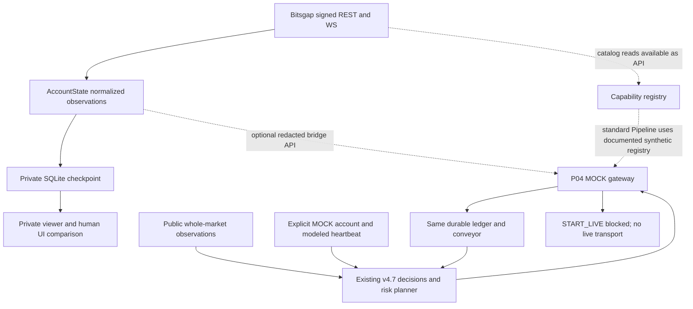

# Independent DAIINAS system and operator-workflow audit — 2026-11-02

**Audit-only response to [Issue #33](https://github.com/rzalags-maker/DAIINAS-pROJ/issues/33). No production changes.**

| Identity | Independently checked value |
| --- | --- |
| Audited P05 source | `4d278da5b0ef13824982f380cb505403455a4ca2` |
| P04 dependency | `4cf4af4a68b054815c40675f54b4a24847c29c17` |
| P03 dependency | `dff5f8b247c3a52c404a6e9d3b7ebf44c75868f7` |
| Current remote main | `97af92639b6fe2f30b6f4289e9c5a6827f72da95` |
| Audit branch | `audit/issue33-independent-system`, created from the exact P05 source |
| Execution host | Linux Codex Cloud; **not** the owner's Mac |
| Owner actions requested during audit | **ZERO** |

Evidence notation: **C** = inspected executable code; **T** = executed offline/synthetic test or probe; **G** = independently inspected Git/GitHub CI metadata; **O** = owner-reported live observations, not independently witnessed here; **D** = provider/repository documentation; **P** = proposal, not implemented. All source citations below are pinned to P05, not moving `main`. No credentials, real financial amounts, provider account/order identifiers or private checkpoints are included.

## 1. One-page executive verdict

**DAIINAS is a substantial, tested PAPER/MOCK engine with a functioning read-only observation subsystem. It is not an operationally complete autonomous live trading product, and the current account acceptance workflow is unnecessarily operator-dependent. Green CI does not contradict either conclusion.**

**What works now.** Signed Bitsgap REST/WS, dynamic Futures scope, explicit WS snapshots, normalized unknown/stale/conflicting observations, the macOS sidecar-lock correction and guarded private output exist. Owner evidence establishes authenticated observation; the audit does not reopen that resolved question. Existing v4.7 scanning, risk planning, Model A, intent/ACK separation, partial-fill/close, MOCK protection, exact-once settlement, replacement and durable STOP/restart are executable. This audit independently ran **509/509 tests** on Python 3.12 and 3.13, verified exact-P05 Python 3.11–3.13 CI, and reran the eight MOCK scenarios. Real order execution remains blocked.

**What is not usable as promised.** The owner must still coordinate two processes, inspect a separate terminal, transcribe a UI sample and race a five-second cohort window. P05 improves invalid-input recovery, not session orchestration or account completeness. A successful private CLI invocation returns exit 0 even for an incomplete/stale comparison; the observer/report CLI returns exit 2 even for successful read observation because the financial gate remains blocked. These incompatible meanings encourage redundant reruns. No single default command currently returns a useful, redacted observation verdict independently of financial admission and optional UI parity.

**What is structurally blocked.** Provider-null orders/positions do not establish a flat account. True free margin, collateral, equity/cost/funding completeness and persistent native protection remain unproven. Moreover, AccountState retains counts/modes rather than a complete per-order/per-position financial inventory. Resolving null alone would not finish that missing mapping. These are not repaired by changing a prompt, extending TTL, a Python upgrade or another timed Mac run.

**Important integration correction.** P04 integrates the strategy and MOCK gateway on one financial writer. It does **not** automatically wire the live Bitsgap observer, live capability discovery and eligible-capital reconciliation into the standard continuous service. `Pipeline` initializes the documented synthetic registry and uses a modeled account heartbeat by default. The AccountState bridge is an API exercised in tests; the production entrypoint does not schedule it. That boundary is financially safer than funding MOCK from a wallet, but earlier broad “complete chain” language exceeded the delivered runtime.

**New verified defects.** Synthetic audit probes reproduced (F1) legacy private CLI output without TTY/with generic CI, (F2) reuse of a previous connected checkpoint merely because a new writer holds its sidecar lock, and (F3) unbudgeted legacy stream startup issuing three position-settings requests inside one second. No real provider was contacted to reproduce them. None is a license to enable live execution.

**What must stop.** Stop repeated manual 180-second/UI-transcription loops as the default engineering acceptance; stop calling fixture success live readiness; stop treating the cloud's missing credentials as failure of the owner's existing connection; stop adding parallel strategy/ledger modules or attempting real orders to manufacture evidence. Keep null unknown and trading disabled.

**One next task.** Implement a single bounded, noninteractive, redacted read-only acceptance command using the existing observer/state/registry. Separate observation success, account completeness, financial admission and optional independent UI parity; cover the three reproduced boundary defects in the same observation-boundary test contract. Exact scope and measurable gates are in §10. This audit implements none of it. **The owner need do nothing for this audit.**

## 2. Method, limits and independently executed evidence

Read `AGENTS.md`, the owner event-driven autonomy contract, the AccountState/private-view/P03/protection documents, v4.7 implementation/policy, actual source/tests, workflows and deployment templates. Fetched current main, all nine PR heads, exact base/head branch metadata and Git ancestry. Reviewed P05's actual diff: only `bitsgap_account_visibility.py` and its tests changed relative to P04 (144 insertions, 17 deletions).

Commands executed against the unmodified P05 worktree:

```sh
# Separate pinned dependency directories, ordinary unittest, no timer helper.
PYTHONPATH=/workspace/p04-deps312 timeout 300 python3.12 -B -m unittest discover -s tests -v
PYTHONPATH=/workspace/p03-runtime-deps timeout 300 python3.13 -B -m unittest discover -s tests -v
PYTHONPATH=/workspace/p03-runtime-deps timeout 120 python3.13 -B scripts/verify_p04.py
```

| Executed check | Result | What it proves / does not prove |
| --- | --- | --- |
| Python 3.12.14, cryptography 46.0.7, websockets 16.0 | 509 run; 509 pass; 0 fail/error/skip; 64.186s | Offline P05 regression; not Mac/network/account acceptance |
| Python 3.13.5, cryptography 43.0.0, websockets 16.0 | 509 run; 509 pass; 0 fail/error/skip; 66.447s | Same distinction; not the owner's Python installation |
| Existing `verify_p04.py` at exact P05, clean worktree | 8 pass; 0 fail/error/skip | A subset of existing synthetic scenarios, **not eight additional unique unit tests** |
| Unittest inventory | 509 unique test IDs | P04's 505 plus four P05 additions; not a line-coverage percentage |
| [Exact-P05 CI run 41372963332][CI] | All three job pages succeeded, Python 3.11/3.12/3.13 | Remote Linux CI; Python 3.11 was **not** executed locally |
| Three additional audit probes (§6) | All three suspected defects reproduced | Isolated synthetic state/wires only; existing suite remained green |

No production feature/test files were edited. Audit probes used temporary generated fixtures/checkpoints and emitted only classifications/booleans. No owner's computer, key file, private checkpoint or UI was accessed. No authenticated provider request, exchange write, merge or deployment occurred. Expanded local command permissions allowed normal asyncio thread notifications; no network policy was bypassed. Pinned package setup is not an owner-host test.

Owner's Issue #33 evidence is retained as **O**, not converted into a new live verification: authenticated 180-second observations, 22 snapshot batches, 88 responses, no rejections; orders/positions remain provider-null. Responses include null and are not 88 proofs of complete accounts. Normal session-end DISCONNECTED is expected. No independent terminal parity was completed.

## 3. Ranked root causes

| Rank / severity / confidence | Category and root cause | Consequence | Minimum correction / falsifiable completion |
| --- | --- | --- | --- |
| **R1 — P0 for live admission; HIGH** | **Provider limitation + incomplete implementation:** no authoritative full exposure/financial/protection evidence; normalized state retains counts/modes, not a complete inventory. | Live admission is correctly blocked. More successful wallet observations cannot supply the missing truth. | Record explicit unavailable fields; obtain supported provider semantics and inventory/protection evidence, then implement a separately reviewed full mapping. Completion requires reconciled quantities/obligations/costs/ownership, not `null`, a UI-zero assertion or a filled-in mock authority. |
| **R2 — P1; HIGH** | **Operational deficiency:** a human terminal-parity ritual is the default acceptance surface; observation, completeness and financial admission have incompatible success/exit meanings. | Unnecessary owner timing/rerun work and misleading “failed test” interpretations despite functioning API observation. | One bounded read-only command; no default prompts; independent per-stage verdicts; capture valid API cohorts automatically without changing TTL. Null must yield useful PARTIAL, not another questionnaire. |
| **R3 — P1; HIGH** | **Missing runtime edges:** actual observation/capability bridge is not scheduled by `continuous`; default registry/account source is synthetic. | “One ledger” is true, but “live account drives the autonomous system” is not. An API hook/test is not an operating connection. | First automate and report the existing read-only path. Do not wire wallet totals into money. Future live capital coupling requires R1's evidence and separate approval. |
| **R4 — P1 before wider operator release; HIGH** | **Test-boundary mismatch:** green fixtures do not test all legacy entrypoints, new-writer/old-checkpoint handoff or unbudgeted stream startup. F1/F2/F3 are verified defects, not provider explanations. | Private output can escape its promised boundary; old data may briefly be called current; legacy paths may violate settings limits. Current no-live gates prevent these becoming order authority. | Shared redaction/session/budget invariants, automated reproductions (§6), no regressions. Do not simply relabel old data or suppress the errors. |
| **R5 — P1 release discipline; HIGH** | **Fragmented release and operator contract:** six dependent Draft PRs remain outside main; older divergent drafts and stale documentation coexist. | Correct code, old main/ZIP, workflow guards and deployment instructions are easily confused. Passing branch CI is not a published operational release. | Review the actual dependency chain, define one source/config/runtime contract and correct contradictory instructions. Merge decisions remain separate; audit performs none. |

R1 is a blocker, not proof of a provider bug or a reason to weaken safety. R2 is the highest immediately implementable owner-time improvement. R4's defects are independently demonstrated; their role in any particular historical Mac symptom is **not** established.

## 4. Actual architecture and traceable evidence matrix

Solid arrows below are operating code paths; dotted arrows are APIs/manual coordination, not an automatically scheduled live integration.



| Claim | Observed code / line / test | Real-environment evidence | Actual conclusion | Missing proof |
| --- | --- | --- | --- | --- |
| E01 Signed REST and no-write topics | [Signer/read allowlist][REST107], `test_signed_payload_and_key_are_verifiable`, `test_command_and_non_allowlisted_topics_rejected_before_network` | O: existing authentication; T: generated signing keys | Request signing and explicit internal/public read-only restrictions implemented; no new auth test here | Current account permissions/availability cannot be inferred from fixtures |
| E02 Dynamic real Futures scope | [Observer discovery][FO224], `_enum_tables` at 63; signed fixture catalog tests | O: authenticated Futures observations | Exact dynamically resolved real Futures code, not Spot/demo or an owner-entered constant | Independent whole-account identity/completeness |
| E03 WS subscribe vs snapshot | [Stream][WS193], `_request_snapshots` 103, `_ingest` 143 | O: 22 batches / 88 responses / 0 rejection | Explicit read snapshots implemented; delayed processing uses actual receive time | Provider request IDs/source-event times are absent; response attribution remains limited |
| E04 Rate budgets | [Bounded worker][AS536], `AccountReadBudget` 56; budget tests at `test_bitsgap_account_state.py:449` | T: positive shared-budget tests; F3 fails for legacy route | Bounded AccountState worker shares topic budget across REST/WS/reconnect | Not universal across all CLI/probe clients or external same-key processes; live stricter catalog limits not automatically applied |
| E05 Null versus zero | [AccountState.ingest][AS335], [_topic][AS407]; null/explicit-zero tests | O: both topics provider-null | `PROVIDER_NO_DATA` is unknown; matching explicit counts only prove the API market view | Complete venue inventory/absence semantics |
| E06 Scope, age, generation, conflict | [AccountState][AS207], [_topic][AS407]; out-of-order/reconnect/foreign-scope tests | O: intermittent validation | Strong fail-closed per-session classification; F2 reveals reader lease gap | Crash/startup incarnation binding; full account identity |
| E07 Inventory retained | [Normalization][AS335] at 367–382 | No live non-null inventory independently inspected | Retains order count and position count/modes; not a full per-order/per-position financial mirror | Owned IDs, quantities, commitments, protection and fill/cost attribution mapping |
| E08 Balance semantics / financial admission | [status/model boundary][AS449], [acceptance report][AA38] | O: wallet observed; no verified equity/free margin/costs | `t/a` are reported amounts only; unknowns and NO_TRADE remain explicit | Authoritative financial-component semantics and eligible capital |
| E09 Private checkpoint security | [PrivateStore][AS112]; sidecar/unsafe-file tests | O: prior Mac lock fix; T: Linux checks | Separate permanent lock, owner-only regular files, symlink/hardlink checks implemented | F2: active lease does not prove saved session belongs to that writer; trusted parent directory remains an assumption |
| E10 Private rendering | [Visibility][VIS30], [TTY guard][VIS233]; redaction tests | No private owner values collected | New visibility path guards TTY/CI and current-vs-last-observed output | Legacy F1 has a different weaker policy |
| E11 Terminal comparison | [Comparison][VIS98], [prompt][VIS175]; P05 input tests | O: no independent parity completed | Private, human-asserted, precision/window-limited comparison; never full account certification | Independent UI observation/identity, not API self-comparison |
| E12 P05 remedy | [P05 prompt][VIS175], tests `test_bitsgap_account_visibility.py:200,220,229,241` | T: P05 regression passes | Lowercase input, invalid precision/sample retries, cancellation and summary work | Orchestration, timing and full-account truth unchanged |
| E13 Capability registry | [Registry][CAP49], discover 130, validator 139, read verification 171; 9 tests | No new authenticated registry execution | Reusable typed metadata; catalog declaration is not write permission | Scheduled live catalog consumption; schema/permission/protective semantics |
| E14 Registry→runtime edge | [Pipeline initialization][PIPE443] at 454–458; `P04MockWorker.__init__` 230–233 | T: registry constructed by tests | Standard pipeline explicitly uses `.documented()` synthetic metadata | No standard automatic authenticated registry discovery/refresh |
| E15 AccountState→runtime edge | [poll/bridge][PIPE543], `continuous.service:132`; bridge test `test_p04_integration.py:247` | No live service chain executed | Model heartbeat by default; redacted bridge exists but production service does not call it | Supported automatic observation bridge, without live-balance funding |
| E16 Whole-market decision engine | `market_pulse.rank_pulse:5`, `market_intelligence.update:20`, `ContinuousObserver.preflight`; whole-market tests | No market session executed in audit | Existing bounded broad scan/deep shortlist and independent direction heuristics | Calibrated economic edge, production data/latency acceptance |
| E17 Model A and early permissions | [CapitalLadder][LAD52], [account capital][AC160] 201–204, 261–276; 15 + 20 tests | T: explicitly MOCK money | Reserve/ACTIVE/reversible slots and under-activation WIN permissions are implemented in the existing financial engine | No verified eligible live capital; reserve not physically exchange-segregated |
| E18 Cost/risk/leverage | [Adaptive selection][AD37], `PortfolioLedger.plan:395`, `mark:340`; sniper/fee tests | T: synthetic quotes/costs | Campaign money cap distinct from price stops; resize or NO_TRADE, never leverage rescue | Actual fee/funding, liquidity, gaps/liquidation and economic expectancy |
| E19 Stable intent / ACK | [Gateway][GW218], durable claim in `_handle_control:145`, transport 29; ACK/crash tests | T: MOCK only | Stable funding+intent command identity; claim before ACK; ACK is not fill | No real dispatch/venue acknowledgment path implemented |
| E20 Partial fill / protective coverage | [Conveyor][CON111], [native validator][EB27]; partial-entry/exit tests | T: modeled or caller-supplied MOCK authority | Residual coverage/quantities and unknown outcomes checked; not venue attestations | Native exchange trigger/reduce-only/child semantics |
| E21 Exact settlement / replacement | [book_exit_slice][CON195], `queue_model_cash:27`, `settle:230`; replay, loss and replacement tests | T: existing durable ledger | No second ledger; final settled campaign, costs and slot release tested once | Correct mapping/retention of real venue events remains absent |
| E22 Modes / live boundary | [Gateway controls][GW101], [inert gateway][EB6], `continuous.main:243` | C/T, no live writes | START_LIVE explicitly blocked; no live transport selectable | Future independent owner authorization and supported live implementation |
| E23 STOP / restart / uncertainty | [Session][SES9], gateway tests 102/113/146/155/216, [service][CONT87] | T: local/mock durability | Local durable disarm; unresolved obligations retain exposure; late ACK does not fake flat | Authenticated remote/mobile command delivery and supervised host ACK |
| E24 Actual service test breadth | [Pipeline test][TP288], `scripts/verify_p04.py:23` | G/T: 8 mocked scenarios | Real ledger/conveyor API integration, but not full observer→registry→service→UI live acceptance | Production profile with candles, actual dependencies/TLS and end-to-end operator lifecycle |
| E25 Deployment / unattended lifetime | `deploy/daiinas-v4.service:1`, `continuous.service:87` | No deployed host inspected | Templates and process loop exist; not proof of installed supervised runtime | On-demand host reliability, liveness/alerts and real remote STOP |
| E26 Release state | Exact heads/table §9; [manual workflow][WF] | G: nine Draft PRs; main lacks AccountState/gateway/new workflow | Test branch is not an integrated published main release | Reviewed release sequence, configuration/backup/replay contract |

## 5. Operator workflow: why input fixes did not fix usability

### Cold start, including non-obvious dependencies

1. Obtain the **correct stacked source**, not old main/ZIP; confirm exact head.
2. Select/activate the correct Python virtual environment; install the existing crypto/WebSocket dependencies.
3. Establish CA trust without disabling TLS checks; a working browser does not configure Python's trust store.
4. Securely provision the existing signing credential **on the owner host**. The observer reads `BITSGAP_PRIVATE_KEY_PEM`; it does not automatically discover an existing PEM file. No key was requested/read here.
5. Prepare a trusted private checkpoint directory and file permissions.
6. Terminal A starts the observer; another terminal activates the same environment, then reads its checkpoint.
7. Inspect at 10/30/50 seconds; launch comparison; corroborate account, enter precision/mode and transcribe five live sample fields.
8. Inspect after stop and expiry; restart observer, repeat live views and optionally comparison. A shutdown checkpoint is correctly disconnected.

**Source-derived workload, not a measured owner timing claim:** one run with three active views, one comparison, post-stop and expiry reads, a restart and three recovery views requires **11 shell invocations**, at least **4 prompt submissions** for one comparison, two terminal contexts and a UI visit. Environment/key/CA preparation, invalid retries and a second comparison are additional. Replacing 60 with 180 seconds changes waiting time, not the architecture.

### The five-second race is intrinsic to this workflow

- Account freshness TTL is 15 seconds; REST refresh is about 5 seconds; explicit WS snapshots are about 8 seconds. These are different concepts.
- `compare_terminal:117–121` requires **now, the human sample and both receipt times** to fit inside the comparison window. Each exposure/mode comparison has a similar condition.
- On an unchanged account with WS snapshots approximately 8 seconds apart, source ages necessarily exceed a 5-second UI comparison window during part of the cycle even while the socket is healthy. Ignoring latency, that interval is about 3 of every 8 seconds; this is an illustrative phase bound, not a measured pass rate.
- P05 retries do not pause/restart the observation worker or coordinate its snapshot phase. A longer interactive session can end while input is being repaired. Reusing NOW changes the local confirmation timestamp, not the UI's true sample time.
- `overall_outcome` also includes inventories and mode; with null inventories it cannot become a complete MATCH merely because amounts match. This is correct truth handling, but a poor mandatory “make everything green” operator objective.

Do not fix this by enlarging TTL, calling stale evidence successful or converting null into zero. Capture a valid **API cohort automatically** and report the cohort's time/age and full-run evidence separately from connection-after-stop. An API self-comparison still cannot prove independent terminal parity.

### Comparison is not a universal prerequisite

| Objective | Must a human transcribe the UI every time? |
| --- | --- |
| Demonstrate authenticated scoped REST/WS observation | No; signed read/TLS/validated source evidence is appropriate |
| Report provider-null or missing fields truthfully | No |
| Test PAPER/MOCK strategy and durable settlement | No |
| Certify same-time terminal/API display parity | Yes, unless a supported independent source supplies that evidence; not presently automated |
| Prove complete live collateral/exposure/protection | UI transcription alone is insufficient; authoritative corresponding evidence is required |

### Error and result contract

`visibility.main:304` returns 0 after displaying incomplete/MISMATCH/STALE results. `account_state.main:656` and `account_acceptance.main:69` return 2 even after a completed valid read because financial admission is blocked. Broad catches at `visibility:309`, `account_state:657` and `account_acceptance:70` collapse distinct local failures. `_post:60` hides TLS details behind NETWORK_UNAVAILABLE; HTTP 401 and 403 are both classified AUTHENTICATION_REJECTED by `safe_diagnostic_category:32`. These choices redact sensitive text, but leave the operator without useful stage attribution.

The next command should distinguish **completed observation**, **partial account truth**, **financial admission blocked**, **normal cleanup**, and actual setup/auth/transport failure. Redaction must be preserved; never recover detail by printing raw exceptions/responses. Exiting normally after collecting a truthful PARTIAL report must not imply permission to trade.

## 6. Verified defects and security assessment

All three probes ran against **unmodified P05**, using existing test fixture classes, temporary files and generated test keys. No real credential or financial value was printed. These are additional audit probes, not claims that the existing 509 tests failed.

### F1 — inconsistent private-output boundary (P1, HIGH confidence)

- **Code:** `bitsgap_futures_cli.main:21–32` checks GITHUB_ACTIONS and --watch but not stdin/stdout TTY or generic CI. Compare `bitsgap_account_visibility.trusted_terminal:17–18`.
- **Reproduction:** patch that CLI's observer with an in-memory fixture whose private panel contains only a synthetic marker; redirect stdout to StringIO; set CI=true and GITHUB_ACTIONS=false. Call `main(['--private-panel'])`.
- **Observed:** exit 0; `private_payload_emitted_without_TTY=true`. The marker's contents were not emitted in audit output.
- **Impact:** an explicit legacy private invocation can write financial output to redirected/shared CI logs despite the documented trusted-terminal rule. No real disclosure was induced in this audit.
- **Resolution test:** every private output entrypoint rejects generic CI and noninteractive input/output **before** key loading/observation, while redacted diagnostics remain usable headlessly.

### F2 — sidecar lease does not bind a checkpoint to its writer incarnation (P1, HIGH)

- **Code:** `PrivateStore.writer_active:171–187`; `AccountState.__init__:232–243`; `visibility.load_state:21`.
- **Reproduction:** write a connected, validated **synthetic** checkpoint; close its writer without writing DISCONNECTED to model process death. Acquire a fresh PrivateStore writer lock without new authenticated observations. Open the normal read-only status reader while timestamps remain inside TTL.
- **Observed:** `new_writer_has_received_any_data=false`, but `view_connection=CONNECTED`, `view_balance_current=true`, `previous_generation_reused=true`.
- **Root cause:** reader trusts saved connected/resync/generation flags whenever *some* writer holds the sidecar. The lock is not a session-incarnation/heartbeat attestation. Normal reconnect and shutdown tests do not cover the handoff gap.
- **Impact:** a cache can briefly be misrepresented as current during restart, or longer if an initializing writer stalls. Full financial admission and live routing remain blocked independently. This is **not** recurrence of the old macOS database-inode flock defect.
- **Resolution test:** kill/start lease handoff, stalled new writer and missing incarnation must remain non-current until that writer's fresh authenticated generation is published. Older checkpoints must safely remain last-observed.

### F3 — legacy WS startup bypasses shared settings budget (P1, HIGH)

- **Code:** `bitsgap_futures_cli._watch:54–61` constructs a default observer with request_budget=None; `BitsgapFuturesStream.watch_once:204–228` performs REST, subscription and explicit snapshot; budget use is conditional at stream:105/215. The bounded AccountState worker installs the budget at `account_state:542–543`.
- **Reproduction:** existing synthetic signed REST fixture plus FakeWS; record only monotonic request times for positions_settings during one `watch_once` with default observer. No real provider calls.
- **Observed:** budget absent; **three settings requests inside one second** (REST, subscribe, snapshot). The documented settings rate is one/second, five/ten seconds, shared across transports.
- **Impact:** “rate limits respected” is true for the bounded worker, not every legacy/probe entrypoint. Real network latency could spread requests, but is not a limiter. This does **not** prove rate limiting caused the owner's null inventories; their bounded worker and zero rejections are different evidence.
- **Resolution test:** all supported observation entrypoints use the shared limiter across setup/reconnect and explicit snapshots; no fixture or fast network can generate this burst.

### Other security findings / explicit assumptions

- Positive: signed canonical bytes, bounded bodies, duplicate-key/nonfinite JSON rejection, no redirects, fixed error classes, explicit internal/public topic allowlists, strict real-Futures scope and no selectable live gateway transport. Do not weaken them.
- `read_only_safety=PASS` at visibility:64 is a constant describing that intended path, not a dynamic test of permissions, every CLI, or provider behavior. It cannot override F1/F3 or serve as live acceptance evidence.
- Positive: hardened private view rejects TTY/CI misuse; private comparison and checkpoint use owner-only files; permanent .lock is not unlinked. P05 summary-only redacts final output but its **local comparison file remains private**.
- Trusted owner directory/filesystem is assumed. File ownership and final-component symlink checks are not provider-signed attestation or protection from an already compromised owner process. Checkpoints are caches, not authoritative signed account records.
- `_ci` recognizes the string true; alternate CI conventions are not a comprehensive secret-output security boundary. Central policy is preferable to divergent entrypoint checks.
- Public WATCH events include counts; any future report must explicitly choose permitted aggregate diagnostics rather than assume all event output is private-data-free.
- No deployed authenticated mobile STOP exists. Local actor strings/source file access describe a filesystem-authorized MOCK contract, not remote caller identity.

## 7. Provider truth, monetary safety and execution conclusions

### Data truth and falsifiable missing proof

| Item | Classification | Evidence / falsifiable resolution |
| --- | --- | --- |
| Scoped signed read mechanism | PROVEN (C/T); historical live O | Rejected writes/demo/foreign scope and generated signature verification; owner auth already established. Not new cloud auth. |
| Existing REST/WS wallet reconciliation | PARTIAL (O) | Intermittently validated; report coherent sample cohorts, not blanket “always current.” |
| Real account identity/completeness | UNVERIFIED | Key-bound market and namespace are not a complete provider account identifier/guarantee. Require supported independent binding/inventory completeness evidence. |
| Null is not zero | PROVEN rule (C/T); actual response O | Preserve state; only supported authoritative absence or complete inventories can resolve it. No trade to manufacture test data. |
| Exact provider cause of null | UNVERIFIED | Empty view, unavailable scope/permissions/data remain hypotheses. Vendor contract plus scoped observations must distinguish them. |
| ONE_WAY | PARTIAL historical O | Exact ONEWAY alias recognized; stale/absent/contradictory evidence is not silently defaulted. No mode changes. |
| Equity/free margin/eligible collateral | UNVERIFIED | `t/a` have no established complete financial equivalence. Require documented fields/obligations and no double subtraction. |
| Fees/funding completeness | UNVERIFIED | History supports some data, not proven complete settled accounting. Need actual per-contract costs, settlement coverage and identifiers. |
| Authenticated command catalog | PARTIAL | Observer already reads catalog for discovery; registry schema API exists but standard pipeline does not invoke live discovery. Catalog presence is not permission. |
| Native TP/SL / reduce-only / siblings / restart survival | BLOCKED for live release | Public contract facts and enum presence are insufficient. Require supported trigger/child/venue persistence semantics and independent evidence. |
| Terminal parity | UNVERIFIED / PENDING_OWNER_VERIFICATION | No supported independent UI source in code; no owner parity was completed. Not needed to report healthy API observation. |

Official provider reference reviewed: `Bitsgap/bitsgap-api-docs@d27611b63d56c65c9797e61d34b40b1f175a7664`. The existing protection audit correctly records contradictory REST/WS command prose; a runtime catalog can clarify declarations, not by itself establish account-specific permissions, trigger behavior or persistence. `order_detail` appears in registry metadata, but is absent from the protected runtime read allowlist: recognized metadata is not the same as a callable integrated operation.

### Strategy and financial controls

Verified in code/tests, not proven profitable:

- Model A keeps Reserve, ACTIVE, pending growth and deficit distinct. Losses debit ACTIVE, never borrow Reserve; funded capacity reverses downward. Reserve is bookkeeping, not guaranteed physical collateral segregation.
- Standalone CapitalLadder bootstrap ceiling remains one; the existing account-capital engine separately tracks earned early candidate permissions after unique settled positive campaigns. A candidate permission is not new money. Above activation, nominal slots remain bounded by funded capital and the ten-slot ceiling.
- Campaign loss budget is 0.5% of allocation; planned per-leg risk at most 0.25% of effective ACTIVE and aggregate at most 1%, with drawdown/correlation/margin constraints. Price-stop experiments at 0.5%/1% are different denominators and resize quantity rather than relax money limits.
- Adaptive selection checks x1–x5 and four liquidity paths, uses conservative protective taker costs and chooses a feasible route/lowest leverage. Higher leverage does not rescue an unaffordable minimum lot. Unknown/crossed/stale data or infeasible cost/risk/target yields NO_TRADE.
- The 2% objective is net on campaign allocation, not raw token movement or marked account ROI. Touching TP is not a fill; partial exits do not generate a final WIN/slot release.
- Existing immutable funding, native fill-ID deduplication, campaign settlement, fees, losses and replay/crash tests provide substantive MOCK assurance. They do not prove actual fees/funding, venue execution, modeled stop-gap bounds or economic expectancy.

Relevant tests include `test_tp_touch_nonfill_then_stop_partial_loss_is_exactly_once`, `test_sigkill_during_auto_settlement_rolls_back_fill_and_replays_once`, `test_partial_winning_target_cannot_hide_residual_gap_loss_or_earn_win`, and account-capital early-WIN/loss-recovery/restart cases. No evidence justifies changing any risk threshold or allocator during this audit.

### Execution/session boundary

The mode gate, exact MockExecutionTransport type, inert place/cancel/modify methods and read-only internal signer all block current real writes. A documented command is not a runtime permission. MOCK_NATIVE authority is a validated **fixture contract**, not a provider-signed fill/protection attestation. Claimed/ACKed uncertain orders preserve obligations at TTL/STOP; known no-fill proof or validated mock receipts resolve them. STOP's durable source sequence is meaningful only after a running writer applies it. CLI source acceptance or a chat reply is not a worker ACK.

Normal process shutdown can durably disarm. SIGKILL/offline operation cannot run reconciliation/scanning; only journal recovery and independently persistent venue protection could cover that, and the latter remains unverified. Unit templates, restart settings and tests do not prove a supervised host is installed or reachable from the owner's phone.

## 8. Coverage: what green CI actually establishes

Selected independently counted modules: read-only REST 33 tests; Futures observer 20; stream 22; WS probe 4; AccountState 34; visibility 24; capability registry 9; account acceptance 5; capital preview 12; Model A 15; account capital 20; P04 CLI 3; P04 integration 25; v4.7 conveyor 28; candles 8. These are subsets of 509 unique tests. **No statement of line/branch coverage percentage is made.**

The eight proof scenarios reuse GatewayTests and generated market/account fixtures. They exercise real ledger/conveyor calculations, but most do not start `continuous.service`, use a real key/network, or operate a separate human UI. Their synthetic training streams are designed to produce qualified events. The direct conveyor fixture normally leaves require_candle_context at its fixture default, while generated v4.7 production profiles require candles. Candle tests exist separately; the eight scenarios are not proof of that full production-profile chain.

Critical missing coverage / unproven assumptions:

1. One production-equivalent command owning observation, metadata discovery, safe cohort capture and normal cleanup, without operator timing/input. No such command exists yet.
2. Real callback→private store→separate reader startup/crash lease handoff (F2); current tests cover normal close/reopen but not a new lock holder with an old connected payload.
3. All legacy private output paths under redirects/generic CI (F1), not only the hardened visibility CLI.
4. Shared limits in legacy stream/probe startup (F3), not only positive AccountReadBudget unit tests.
5. Production profile with required candles plus observer/registry/optional account bridge and existing pipeline in one bounded fixture session. The pipeline test at `test_p04_integration.py:288` checks modes/boot/STOP but does not run the full public/private service chain.
6. Real TLS/proxy/setup/dependency errors and useful redacted classification. The standard workflow installs cryptography, **not websockets**; injected wires avoid proving a production WebSocket dependency installation/handshake.
7. Real partial-fill/order/position completeness, native persistence, latency, profitability, unattended lifetime and remote STOP delivery. None follows from mocked truth assertions.

Some stream tests deliberately shorten the polling interval to 0.01 or 0 seconds and freeze clocks. They are useful branch regressions, not measured proof of the human five-second window or production latency. CI does not run the private owner comparison. There are no failures or skips hidden in the audited full runs; additional audit probes expose requirements that the current suite simply does not assert.

## 9. Actual PR graph, release and rollback discipline

All nine PR pages were independently observed Draft. Git heads match:

| PR | Actual head | Target branch | Relationship |
| --- | --- | --- | --- |
| #26 | `3f3baba04392a19946e73c84f4d8c80ea835b504` | main | Ancestor of P05, not in current main |
| #28 | `402b533e55fc3f85be3d977025be59d6b6df13ab` | feature/bitsgap-futures-account-state | Descends from #26 |
| #29 | `37974625d509f3e15c5954117d3504b5a0abc0d3` | feature/futures-private-visibility | Descends from #28 |
| #30 | `dff5f8b247c3a52c404a6e9d3b7ebf44c75868f7` | fix/p02-macos-sqlite-sidecar-lock | Descends from #29 |
| #31 | `4cf4af4a68b054815c40675f54b4a24847c29c17` | feature/p03-bitsgap-ws-snapshot-reconciliation | Descends from #30 |
| #32 | `4d278da5b0ef13824982f380cb505403455a4ca2` | feature/p031-p04-integrated-mock | Descends from #31; exact audit base |
| #7 | `4644bdd677318a780cd9880933108228f6f39412` | daiinas-v1 | Head already ancestor of main/P05 despite Draft state |
| #9 | `9940a01ab224f90b3611a8e0e5127a0da4cff796` | feature/v33-continuous-paper | Independent/divergent from current main/P05; overlapping capital/AGENTS/test files |
| #13 | `3e54e26d421a8ae7d9fc8a3c5a1e20cf12fa5af5` | feature/v4-ladder-integration | Independent mirror/control prototype, not current gateway; diverged from current target head `0a9bbc8a90da15e4e022496b808fa74802756ac9` |

```text
main → #26 → #28 → #29 → #30 → #31 → #32 → this audit
```

The six stacked heads descend from their current bases. That is not a guarantee against conflicts after future edits/squash/retarget. No merge was attempted. Older #9/#13 are not prerequisites to merge into this chain; blindly including them risks reintroducing independent prototypes or conflicting policy documentation. #13's UI-reported baseSha differs from the actual current target-branch head; ancestry was checked against the fetched real head, not guessed from unavailable objects.

Current main contains neither AccountState nor P04 gateway nor the new account-state workflow. The new manual workflow is branch-guarded to main at line 15, so running it on a feature ref is not an acceptance substitute; deploying/reviewing the stacked implementation is a separate release decision. The ordinary research test matrix is offline and has no private observation secret use.

A future reviewed release must choose/pin the dependency chain, retarget/revalidate each step after any approved merge, keep funding identity and source/ledger pairs together, and define forward/replay compatibility. P04 introduces CONTROL records/checkpoint metadata older binaries do not understand; rollback is not “run an old ZIP against the newest ledger.” Use matched backups and a reviewed recovery path, never drop unknown obligations or reset INITIAL_FUNDING.

Documentation contradictions are real: `V47_IMPLEMENTATION.md:151–158` still says a five-hour default/maximum and old STOP-as-pause semantics, conflicting with its opening correction, AGENTS and executable session code. AGENTS also retains historical one-position/not-integrated prose beside newer implementation instructions. Public provider command-transport prose conflicts are already recorded in the protection audit. These are release/documentation deficiencies, not permission to guess behavior or implement real writes.

## 10. Exactly one next implementation task — not executed in this audit

**Task title: P05.1 — single-command, noninteractive read-only acceptance with session-bound evidence.**

**Goal:** extend the existing account acceptance entrypoint so an already provisioned trusted host can run one bounded command and receive a redacted PASS/PARTIAL/BLOCKED report without coordinating terminals, transcribing amounts or racing a snapshot window. Complete the safely automatable observation path; do not implement strategy, live capital mapping, a dashboard or trading transport.

Proposed command contract (does not exist at P05):

```sh
python -m daiinas.bitsgap_account_acceptance --observe --seconds 60
```

**Minimal file plan:** extend `bitsgap_account_acceptance.py`; add optional sanitized sample/lifecycle hooks in `bitsgap_account_state.py`; use the existing registry discovery and existing budget rather than new adapters. Align supported legacy CLI/factory boundaries in `bitsgap_futures_cli.py` / `bitsgap_futures_stream.py` as needed for F1/F3. Fix F2's session-incarnation invariant in the existing private-store/status-reader path, not a second database. Add focused tests and update the current runbook/workflow dependency setup. Leave strategy, money, Model A, risk, P04 order state and live permissions untouched.

Ready, measurable acceptance gates:

1. **No default prompts, no user-entered market number, no UI prerequisite.** Use existing signed scope discovery. Secure local credential resolution uses the already provisioned environment or explicitly selected owner-host file with private-file checks; never read that file from Codex, request its value or extract GitHub Secrets.
2. The command owns setup, read-only observation and cleanup. It collects and retains validated **during-session API cohorts** in memory before normal disconnection; default public output/persistence contains no balances, keys, account/order IDs or signed raw frames.
3. Output separates transport/auth, scoped wallet coherence, catalog declaration, each inventory state, position mode, financial admission and terminal parity. Include counts/times of **observation samples**, not private account contents. Terminal parity remains PENDING_OWNER_VERIFICATION absent an independent source.
4. Healthy scoped observations plus provider-null inventories produce informative **PARTIAL**, with NULL_IS_NOT_ZERO / EXPOSURE_UNVERIFIED reasons. All completed read observation must not be mislabeled a failed session because live financial admission is blocked. Actual setup/auth/no-evidence failure gives BLOCKED. Any PASS describes the observation procedure only, never capital/trading readiness.
5. Preserve configured TTL/comparison windows. Do not promote stale, cross-generation, foreign or contradictory evidence. Bind checkpoint liveness to the current writer incarnation/heartbeat; a fresh lease with an old connected payload must fail F2's reproduction.
6. Private output checks must be consistent across supported entrypoints and happen before key/network access. F1's non-TTY/generic-CI fixture must produce no private marker. Default redacted command must work headlessly in injected offline tests.
7. Reuse the shared REST/WS rate budget across setup/snapshots/reconnect, including supported legacy aliases. F3's startup fixture cannot exceed the documented settings bounds. Do not invent stronger live rate declarations than the actual catalog provides.
8. Normal bounded stop must report `connection_after_stop=DISCONNECTED` while retaining accurately timestamped historical session evidence. Do not call it a transport failure. Real disconnect/auth rejection/timeout and invalid data need fixed, meaningful per-stage reasons, not raw exception output. Document setup and cleanup bounds instead of promising exactly 60 wall-clock seconds while synchronous discovery is outside the timer.
9. Injected tests cover healthy/no-change account, null inventories, explicit empty/active data, no-data timeout, schema mismatch, scope mismatch, stale cohort, differing source phase, reconnect, old writer/new lease, normal stop, private-output rejection and budget saturation. No Mac/key/real order/owner interaction is required to implement or test these gates.
10. Full 3.11–3.13 regression remains green. Preserve NO_TRADE_ACCOUNT_NOT_RECONCILED, START_LIVE unavailable and all read-only allowlists. No new financial normalization, live-write operation, mode/margin change, ledger reseed or automated UI matching in this task.

This is one observation-boundary/orchestration patch with explicit safety invariants, not “finish every trading feature.” It makes the existing truthful limitations visible automatically. Provider inventory semantics, full capital mapping and native protection remain separate, visible blockers; no more unbounded owner-test loop is the acceptance criterion.

## 11. Final disposition and owner action

**Audit verdict:** the existing read-only and PAPER/MOCK implementation is substantive and reproducibly green, but operational product completeness is **PARTIAL**, live admission **BLOCKED**. There is no basis to call it fully autonomous, economically validated or ready to trade. The three confirmed defects and missing runtime links prevent a blanket “all safety/workflow properties proven” statement.

**Owner action required during this audit: NONE.** No new terminal output, key, screenshot, comparison, Mac run or test order is requested. The next task can be implemented and tested with deterministic injected inputs and CI. Vendor evidence and future independent hosting are engineering release dependencies, not instructions for the owner to repeat 180-second sessions.

Only this audit document is added on the audit branch. No source/test/workflow feature was changed, no existing draft was rewritten, and no merge/deployment/exchange action occurred. The audit Draft PR targets `fix/p05-terminal-acceptance-input-20261102`; if API creation is blocked, the delivery supplies the pushed audit commit and compare link rather than inventing a PR URL.

## Pinned source references

[CI]: https://github.com/rzalags-maker/DAIINAS-pROJ/actions/runs/41372963332
[REST107]: https://github.com/rzalags-maker/DAIINAS-pROJ/blob/4d278da5b0ef13824982f380cb505403455a4ca2/daiinas/bitsgap_readonly.py#L107
[FO224]: https://github.com/rzalags-maker/DAIINAS-pROJ/blob/4d278da5b0ef13824982f380cb505403455a4ca2/daiinas/bitsgap_futures_observe.py#L224
[WS193]: https://github.com/rzalags-maker/DAIINAS-pROJ/blob/4d278da5b0ef13824982f380cb505403455a4ca2/daiinas/bitsgap_futures_stream.py#L193
[AS112]: https://github.com/rzalags-maker/DAIINAS-pROJ/blob/4d278da5b0ef13824982f380cb505403455a4ca2/daiinas/bitsgap_account_state.py#L112
[AS207]: https://github.com/rzalags-maker/DAIINAS-pROJ/blob/4d278da5b0ef13824982f380cb505403455a4ca2/daiinas/bitsgap_account_state.py#L207
[AS335]: https://github.com/rzalags-maker/DAIINAS-pROJ/blob/4d278da5b0ef13824982f380cb505403455a4ca2/daiinas/bitsgap_account_state.py#L335
[AS407]: https://github.com/rzalags-maker/DAIINAS-pROJ/blob/4d278da5b0ef13824982f380cb505403455a4ca2/daiinas/bitsgap_account_state.py#L407
[AS449]: https://github.com/rzalags-maker/DAIINAS-pROJ/blob/4d278da5b0ef13824982f380cb505403455a4ca2/daiinas/bitsgap_account_state.py#L449
[AS536]: https://github.com/rzalags-maker/DAIINAS-pROJ/blob/4d278da5b0ef13824982f380cb505403455a4ca2/daiinas/bitsgap_account_state.py#L536
[AA38]: https://github.com/rzalags-maker/DAIINAS-pROJ/blob/4d278da5b0ef13824982f380cb505403455a4ca2/daiinas/bitsgap_account_acceptance.py#L38
[VIS30]: https://github.com/rzalags-maker/DAIINAS-pROJ/blob/4d278da5b0ef13824982f380cb505403455a4ca2/daiinas/bitsgap_account_visibility.py#L30
[VIS98]: https://github.com/rzalags-maker/DAIINAS-pROJ/blob/4d278da5b0ef13824982f380cb505403455a4ca2/daiinas/bitsgap_account_visibility.py#L98
[VIS175]: https://github.com/rzalags-maker/DAIINAS-pROJ/blob/4d278da5b0ef13824982f380cb505403455a4ca2/daiinas/bitsgap_account_visibility.py#L175
[VIS233]: https://github.com/rzalags-maker/DAIINAS-pROJ/blob/4d278da5b0ef13824982f380cb505403455a4ca2/daiinas/bitsgap_account_visibility.py#L233
[CAP49]: https://github.com/rzalags-maker/DAIINAS-pROJ/blob/4d278da5b0ef13824982f380cb505403455a4ca2/daiinas/bitsgap_capabilities.py#L49
[PIPE443]: https://github.com/rzalags-maker/DAIINAS-pROJ/blob/4d278da5b0ef13824982f380cb505403455a4ca2/daiinas/continuous_paper.py#L443
[PIPE543]: https://github.com/rzalags-maker/DAIINAS-pROJ/blob/4d278da5b0ef13824982f380cb505403455a4ca2/daiinas/continuous_paper.py#L543
[LAD52]: https://github.com/rzalags-maker/DAIINAS-pROJ/blob/4d278da5b0ef13824982f380cb505403455a4ca2/daiinas/capital_ladder.py#L52
[AC160]: https://github.com/rzalags-maker/DAIINAS-pROJ/blob/4d278da5b0ef13824982f380cb505403455a4ca2/daiinas/account_capital.py#L160
[AD37]: https://github.com/rzalags-maker/DAIINAS-pROJ/blob/4d278da5b0ef13824982f380cb505403455a4ca2/daiinas/adaptive_execution.py#L37
[GW101]: https://github.com/rzalags-maker/DAIINAS-pROJ/blob/4d278da5b0ef13824982f380cb505403455a4ca2/daiinas/p04_gateway.py#L101
[GW218]: https://github.com/rzalags-maker/DAIINAS-pROJ/blob/4d278da5b0ef13824982f380cb505403455a4ca2/daiinas/p04_gateway.py#L218
[CON111]: https://github.com/rzalags-maker/DAIINAS-pROJ/blob/4d278da5b0ef13824982f380cb505403455a4ca2/daiinas/position_conveyor.py#L111
[CON195]: https://github.com/rzalags-maker/DAIINAS-pROJ/blob/4d278da5b0ef13824982f380cb505403455a4ca2/daiinas/position_conveyor.py#L195
[EB6]: https://github.com/rzalags-maker/DAIINAS-pROJ/blob/4d278da5b0ef13824982f380cb505403455a4ca2/daiinas/execution_boundary.py#L6
[EB27]: https://github.com/rzalags-maker/DAIINAS-pROJ/blob/4d278da5b0ef13824982f380cb505403455a4ca2/daiinas/execution_boundary.py#L27
[SES9]: https://github.com/rzalags-maker/DAIINAS-pROJ/blob/4d278da5b0ef13824982f380cb505403455a4ca2/daiinas/paper_session.py#L9
[CONT87]: https://github.com/rzalags-maker/DAIINAS-pROJ/blob/4d278da5b0ef13824982f380cb505403455a4ca2/daiinas/continuous.py#L87
[TP288]: https://github.com/rzalags-maker/DAIINAS-pROJ/blob/4d278da5b0ef13824982f380cb505403455a4ca2/tests/test_p04_integration.py#L288
[WF]: https://github.com/rzalags-maker/DAIINAS-pROJ/blob/4d278da5b0ef13824982f380cb505403455a4ca2/.github/workflows/bitsgap-account-state.yml#L15
