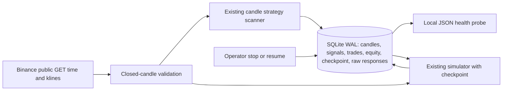

# Independently hosted scanner and paper service

This is an executable Linux service foundation, not an already deployed service.
Live Binance connectivity and historical validation are still blocked in the
current Codex instance. An independent host has not been provisioned or tested.
The existing strategy and simulator are reused; the simulator gained optional
checkpoint/continuation support without changing default batch finalization.

## Boundaries and data flow



No order endpoints, private account endpoints, API keys, broker SDK, or live
execution switch exist. The source permits only public GET `/fapi/v1/time` and
`/fapi/v1/klines`. Frozen public exchange rules are loaded from disk using the
existing validated parser. No API credentials are needed. Binance's documentation:

- [USD-M kline endpoint](https://developers.binance.com/docs/derivatives/usds-margined-futures/market-data/rest-api/Kline-Candlestick-Data)
- [Public archive description, including the REST data source](https://github.com/binance/binance-public-data#futures)

The service is a closed-candle research scanner with delayed paper accounting.
It records simulated next-open fills after the corresponding candle closes,
using the same conservative candle model as backtesting. It does not model a
real-time executable quote or certify that those fills were available. Scanner
signals are stored even when risk controls reject entries or the account is
halted. Strategy signals still use only completed candles; no order-flow claims.

## Run locally or on a Linux host

Python 3.11+ and the standard library suffice. Use a dedicated unprivileged user,
a local persistent filesystem, and the existing checkout (no worktree needed).
HTTPS access to `fapi.binance.com` is required; archive validation additionally
uses `data.binance.vision`. Preserve host proxy/CA trust when applicable.

First obtain actual public rules through the download command. Do not invent a
rules snapshot to work around a connectivity failure:

```bash
python -m daiinas download --config configs/default.json
python -m daiinas backtest --config configs/default.json --output reports/default
python -m daiinas.service run --config configs/service.json --db state/paper.sqlite3 --rules-file data/exchangeInfo.json --once
python -m daiinas.service run --config configs/service.json --db state/paper.sqlite3 --rules-file data/exchangeInfo.json
```

`--once` performs one poll and exits; it does not force-close positions. Continuous
mode polls every 10 seconds by default and processes only completed 5m candles.
`1m` and `15m` are also supported. Service configuration has no historical dates
or train/test split. Strategy and risk defaults remain the v1 defaults, including
8 USDT. The process must keep running on the independent host; Codex live
processes are not a hosting solution and do not survive publication reliably.

## Durable processing and recovery

- SQLite uses WAL, `synchronous=FULL`, and explicit write transactions. One
  transaction commits fetched bars, candidate signals, paper fills, equity,
  cumulative statistics, heartbeat and checkpoint. A failed transaction rolls
  everything back; fetching itself occurs before acquiring the write transaction.
- Unique keys on symbol/time, signals, trades, and equity guard duplicate writes.
  A local advisory file lock excludes a second worker for the same database.
  Run one worker on one host per DB. Do not put SQLite on shared network storage.
- Checkpoints include cash, equity peak, drawdown halt, both-side positions,
  fees/funding, pending next-open signals, pending invalidations, rejection counts
  and cumulative closed-trade statistics. They never sample-end-close paper legs.
- On cold start, preceding candles warm indicators; paper processing begins with
  the latest completed candle. On restart, fetch exactly the missing completed
  candles after the checkpoint, in batches of at most 500. Reuse the persisted
  indicator warm-up and the existing simulator; do not replay settled trades.
- Missing/duplicate/unsynchronized/open candles, excessive host/exchange clock
  difference (>60 seconds), or a backlog exceeding `max_catchup_bars` (default
  1000) stops advancement with an error. The last good account remains intact.
- Missing-period trades are **recovery simulations**, not fills observed while
  the process was offline. All processing batches are timestamped in `events`;
  raw responses include fetch time, URL, SHA-256 and bytes in `responses`.
- Source/cost/strategy/rule changes reject the existing account identity. Create
  a new database for a new experiment. Never reset the old account to erase
  losses or copy a checkpoint into a different experiment. Public rules are a
  frozen current snapshot, not historical filters or continuously refreshed rules.
- Retry failures with bounded exponential backoff (up to 300 seconds). No inputs
  or checkpoint advance after a failed fetch. SIGTERM allows the in-flight bounded
  fetch/atomic batch to finish, then exits. Persistent stop state is separate.

## Operational stop and health

```bash
python -m daiinas.service stop --db state/paper.sqlite3
python -m daiinas.service health --db state/paper.sqlite3
python -m daiinas.service resume --db state/paper.sqlite3
python -m daiinas.service backup --db state/paper.sqlite3 --backup-to backups/paper-001.sqlite3
```

Stop writes a durable flag immediately. A worker checks it before fetching and
again inside its commit transaction; after the stop command returns, later batches
cannot commit until resume. Already in-flight network requests may finish. The
worker remains alive with a `stopped` heartbeat. Stop **freezes** paper positions,
pending decisions and accounting; it does not invent a liquidation price. Resume
recovers missing bars within the configured limit. Thus resumed trades can be
retrospective recovery simulations. Terminate the OS process as well if network
requests must stop immediately. Stop and resume never affect real funds.

`health` emits JSON and exits 0 only for a recent running/stopped heartbeat; an
active worker also needs fresh market data. An intentional stopped state is
visible and can be healthy; it does not mean paper trading is active. Exit 1
indicates unhealthy/uninitialized/shutdown, stale data/heartbeat, or a fetch error.
JSON includes cash balance, marked equity/P&L, open positions, drawdown halt,
closed-trade statistics and the last processed bar. `net_pnl` in ongoing paper
mode is the cash change including fees/funding on open legs; `marked_net_pnl`
also includes unrealized P&L and estimated exit costs. Average trade profit uses
only closed-trade net P&L. Flat historical reports keep their original semantics.

Use the online `backup` command for a consistent snapshot. Do not copy only the
SQLite main file while WAL is active. Back up off-host, verify restore on a copy,
monitor disk space and process memory, and retain the public rules/config/source
used. Candle, event and raw-response history grows without automatic deletion;
capacity/retention policy is a hosting responsibility. Never delete checkpoint
warm-up or audit data blindly. A backup clone is a separate account, not a second
concurrent worker for the same production identity.

## systemd hosting templates

Files under `deploy/` are templates for a dedicated Linux host. They have not
been installed or run against a live provider here. Static `systemd-analyze verify`
passed for all three unit files. Review the paths and Python
version first. Suggested layout:

- `/opt/daiinas`: this checkout, including `configs/service.json`, read-only to worker
- `/var/lib/daiinas`: persistent SQLite state and the downloaded public `exchangeInfo.json`
- Dedicated `daiinas` user and group; no exchange credentials

After host provisioning and a successful public-data/`--once` smoke test, an
operator can install the templates and enable them:

```bash
sudo install -m 644 deploy/daiinas-paper.service deploy/daiinas-health.service deploy/daiinas-health.timer /etc/systemd/system/
sudo systemctl daemon-reload
sudo systemctl enable --now daiinas-paper.service daiinas-health.timer
sudo journalctl -u daiinas-paper.service
sudo systemctl status daiinas-health.service
```

Provision the dedicated account and checkout first. `StateDirectory=daiinas`
creates persistent state storage for the worker. Copy the **downloaded** rules
snapshot there with read permission for the worker before startup. Set system
proxy/CA configuration if the independent host needs it. No API keys are used.
The worker restarts on process failure. The timer probes health each minute;
connect failed health units/nonzero probes to the host's monitoring/alerting
system. No alerts are sent by this repository, and no remote management or
unauthenticated web control port is exposed.

Live provider acceptance, multi-day soak tests, supervisor startup, disk-full
behavior on the chosen filesystem, alert delivery, and off-host restore remain
host deployment checks, distinct from passing offline lifecycle tests.
